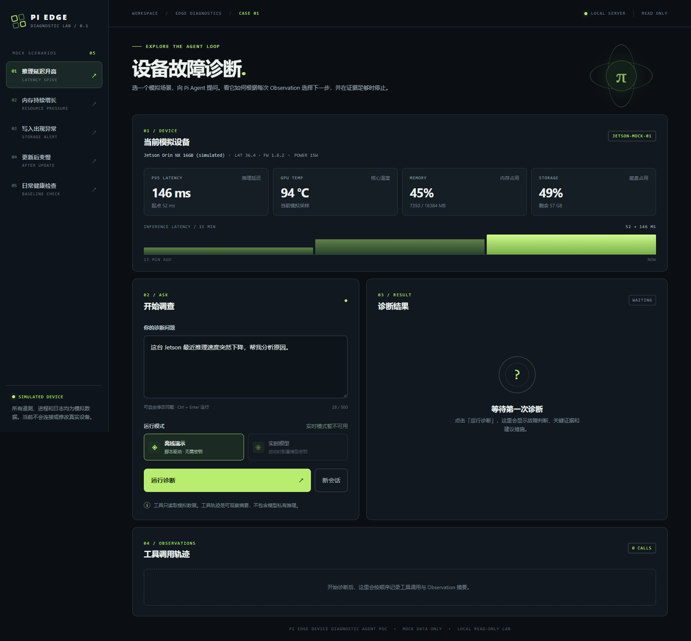
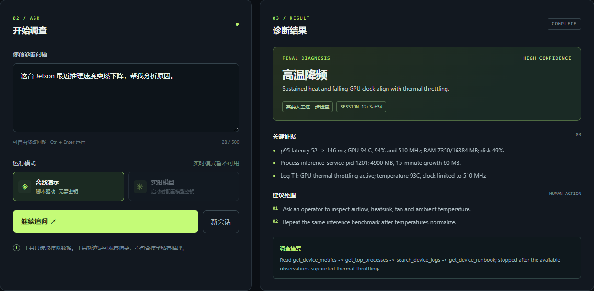
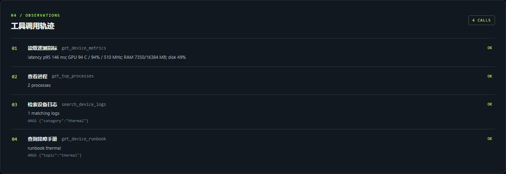
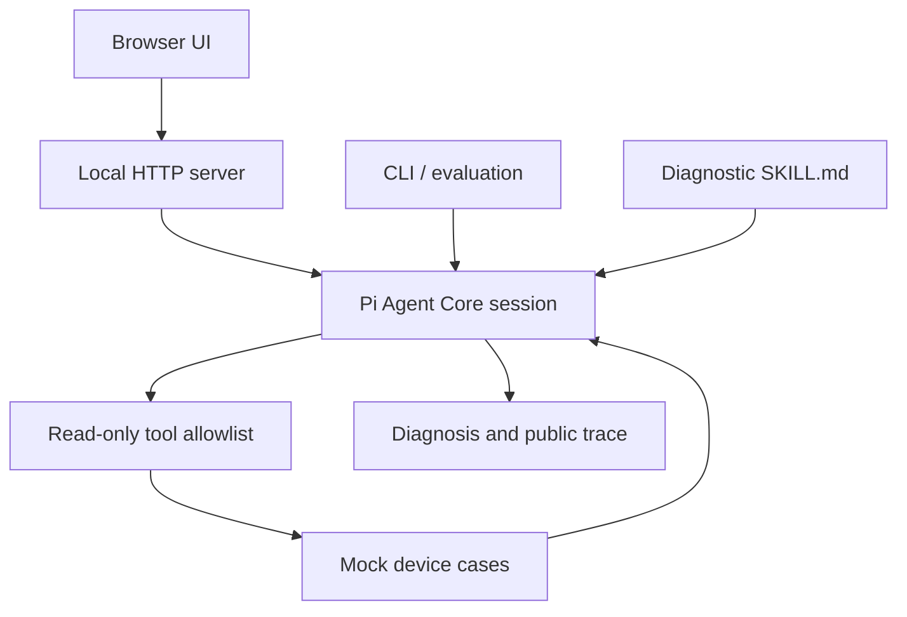

# Pi Edge Device Diagnostic Agent PoC

**Pi Agent Core + TypeScript/Node.js · 6 read-only tools · 5 mock diagnostic cases.** Ask about a simulated edge device, watch the agent inspect observations, and get an evidence-backed diagnosis. This is a personal technical feasibility PoC built with [Pi Agent Core and Pi AI](https://github.com/earendil-works/pi).

> **Scope:** I do not currently have a real NVIDIA Jetson. Telemetry, processes, logs, and changes are mock data; this project has not been validated on real hardware.

## Web UI preview

These screenshots were captured from the running local web app with the `thermal` mock case. They show the **scripted offline mode**: Pi executes the tools and returns observations, while the next tool choice is scripted. They do not represent a live Jetson or an LLM reasoning benchmark.



The dashboard lets you choose a case, inspect its simulated telemetry, and ask a diagnostic question.



After running the thermal case, the result panel reports high-temperature throttling with evidence and human-operated recommendations.



The trace lists the four read-only tools called in this offline run. It shows tool observations, not private model reasoning.

## Try it locally

With Node.js **>=22.19**, you can explore the five mock cases without an API key:

```bash
npm ci --ignore-scripts
npm run web
```

Open `http://127.0.0.1:4173`, select a case, and click **运行诊断**. The default **离线演示** mode is scripted; [live model setup](#how-to-run) is optional and still uses mock device data.

## Tech stack at a glance

| Role | Technology | Used for |
| --- | --- | --- |
| Agent harness | **Pi Agent Core** (`@earendil-works/pi-agent-core`) | Agent loop, tool calls, in-memory sessions, events, and safety hooks |
| Model integration | **Pi AI** (`@earendil-works/pi-ai`) | DeepSeek/OpenAI live providers and a scripted offline provider |
| Backend | **TypeScript + Node.js** | Agent, tools, mock simulator, local HTTP API, CLI, and evaluation runner |
| Data contracts | **TypeBox** | Tool and report schemas with runtime validation |
| Browser demo | Plain JavaScript, HTML, and CSS | Local interface for trying the same backend agent |

The agent receives a question, calls a read-only mock tool, observes its result, and chooses whether to investigate further or return a diagnosis. The live model makes those choices through Pi's agent loop; the offline demo follows a scripted observation consumer. See [`src/agent.ts`](src/agent.ts) for the Pi session and [`src/tools.ts`](src/tools.ts) for the tool boundary.

## Why this project

I have used LangChain `create_agent` and Deep Agents. Here I want to inspect a smaller agent harness directly: tool calling, observation-driven next steps, session reuse, termination, tool errors, and a strict read-only capability set.

## Why Edge Device Diagnostics

Inference latency can worsen for different reasons that look similar in a user report. Temperature, memory, storage, and software changes provide distinct evidence paths. A diagnostic agent is a useful way to test whether the next inspection follows the latest observation instead of a single predefined sequence.

## Inspiration and attribution

The diagnostic dimensions and safety approach are inspired by **NVIDIA Jetson Device Skills** by NVIDIA-AI-IOT: [project](https://github.com/NVIDIA-AI-IOT/jetson-device-skills), [jetson-diagnostic](https://github.com/NVIDIA-AI-IOT/jetson-device-skills/blob/main/skills/jetson-diagnostic/SKILL.md), and [jetson-perf-investigator](https://github.com/NVIDIA-AI-IOT/jetson-device-skills/blob/main/agents/jetson-perf-investigator.md). NVIDIA's work groups device identity, memory, GPU, thermal, power, storage, services, and processes into agent-friendly observations, and separates read-only investigation from actions that need confirmation.

This project is an independent mock implementation. It does **not** copy NVIDIA scripts or claim to implement their live Jetson skills. In NVIDIA's skills, `SKILL.md` gives agent instructions, `scripts/` collect device data, and `references/` explain platform details. Here `SKILL.md` gives investigation instructions, TypeScript tools read JSON fixtures, and a small runbook module supplies guidance. There are no host shell scripts because this PoC never touches a device.

## Why Pi Agent

Pi exposes a small [Agent core API](https://github.com/earendil-works/pi/blob/main/packages/agent/README.md) with an agent loop, tool schemas, events, session ID, and hooks. The [Pi AI API](https://github.com/earendil-works/pi/blob/main/packages/ai/README.md) supplies OpenAI and [DeepSeek](https://github.com/earendil-works/pi/blob/main/packages/ai/src/providers/deepseek.ts) providers plus an official scripted faux provider for offline harness checks. The code uses the current `@earendil-works/*` package namespace and requires Node.js 22.19 or newer.

## Why not LangGraph or Deep Agents

The goal is to observe one agent's tool choices and termination with minimal surrounding machinery. A graph runtime, multi-agent delegation, and durable orchestration would add concepts this experiment does not need. The live model chooses tools after each observation; the host code supplies only capabilities, schemas, a safety guard, and a tool budget.

## Architecture



`src/agent.ts` creates an in-memory Pi session. `src/tools.ts` registers only diagnostic tools; `src/simulator.ts` loads one validated case from `mock_data/cases/`. The browser in `public/` talks to the local, loopback-only `src/web-server.ts` API; it uses the same agent as the CLI. The `beforeToolCall` hook reinforces the allowlist and limits repeated calls. The session can answer more than one question, but conversations are not persisted. Only tool names, arguments, short observation summaries, and the final report are displayed; model private chain-of-thought is never printed or saved.

## Local Web UI

Run `npm run web` and open `http://127.0.0.1:4173`. Select one of the five mock cases, edit the question, and click **运行诊断**. The result panel shows the diagnosis, evidence, recommendations, human-check flag, and a public tool trace. **新会话** resets the current Pi session; asking again without resetting reuses it. The telemetry strip is a preview of the selected fixture, not a live sensor feed.

The UI defaults to **离线演示** when no model key is configured. This mode uses the scripted faux provider and is useful for exploring the flow, but it does not test model reasoning. If the server starts with `PI_PROVIDER=deepseek` and `DEEPSEEK_API_KEY` in its environment, **实时模型** becomes available and is selected by default. The key stays on the local server and is never sent to browser code. The server binds only to `127.0.0.1`, exposes fixed case IDs, and cannot access arbitrary paths or run device actions.

## Agent Loop

For a performance complaint, the skill asks the agent to inspect metrics early. Thermal observations can lead to process and thermal-log checks; high RAM can lead to process growth and OOM logs; nearly full storage can lead to storage logs; normal resources with high latency can lead to change history. A healthy snapshot should end early. These are investigation hints, **not a hardcoded live workflow**: the real model may use any available read-only tool in any supported order and stop when evidence is sufficient.

The offline mode uses Pi's `fauxProvider` with a deterministic observation consumer. It proves that Pi actually executes tools, returns observations, continues the loop, and terminates. It does **not** prove an LLM independently selected the right tools. Live mode runs Pi against the selected provider and validates the final JSON report; if the model returns a malformed report, it gets one format-only correction turn.

## Tools

| Tool | Input | Output |
| --- | --- | --- |
| `get_device_info` | `{}` | Simulated identity, software versions, power mode, service states |
| `get_device_metrics` | `{}` | Three samples across 15 minutes: latency, GPU, thermal, RAM, swap, disk, CPU, power |
| `get_top_processes` | `{}` | Simulated process CPU, memory, memory growth, GPU memory |
| `search_device_logs` | Optional `category` and `limit` (1–20) | Matching structured log events |
| `get_change_history` | `{}` | Recent software and firmware changes |
| `get_device_runbook` | `topic`: thermal, memory, storage, regression, healthy | Checks and human-operated recommendations |

Inputs and outputs have TypeBox schemas; fixture data and tool outputs are validated. Pi rejects invalid tool arguments as error observations. Tool code also throws on failures, which Pi exposes to the model as errors. No tool accepts a filesystem path or command from the model.

## Mock Device Simulator

Each fixture contains `device`, a time-windowed `metrics` series, `processes`, `logs`, and `changes`. The loader accepts only five fixed case IDs; it does not turn user input into a path. Replacing this adapter with a real collector is the main future hardware step.

## Demo Cases

| Case | Evidence | Expected diagnosis |
| --- | --- | --- |
| `thermal` | Sustained hot GPU, falling clock, higher latency, throttle log | `thermal_throttling` |
| `memory` | Rising RAM/swap, growing process, OOM log | `memory_pressure` |
| `disk` | 99% disk use, write failure, oversized debug log | `disk_full` |
| `regression` | Normal resources, higher latency, simultaneous runtime/firmware updates | `software_regression` (component not isolated) |
| `healthy` | Stable latency and resources | `healthy` |

## Evaluation

`npm run evaluate` emits one JSON line per case with `passed`, `diagnosisMatches`, `stoppedEarly`, `tools`, `toolCalls`, and `terminated`. `npm run evaluate -- --live` runs the same cases with the configured model. Healthy passes the early-stop check only when it uses at most two tools. A `passed` result in the default **scripted offline** mode checks harness wiring and fixture consistency; it is not a model-quality benchmark. Live results may vary with provider, model, and prompt and must be reported separately.

The scripted offline result is 5/5: thermal 4 calls, memory 4, disk 3, regression 4, and healthy 1. In one real `deepseek-flash` run on 2026-10-19, all five diagnoses matched and terminated: thermal 4 calls, memory 6, disk 3, regression 5, and healthy 1. This is a smoke test on mock devices, not a reliability benchmark. Five tests cover fixture routing, tool errors, session reuse, report parsing, and the local UI's HTTP flow.

## Example output

Excerpt from `npm run demo -- --case thermal` (scripted offline):

```json
{
  "diagnosis": "thermal_throttling",
  "faultJudgment": "Sustained heat and falling GPU clock align with thermal throttling.",
  "evidence": [
    "p95 latency 52 -> 146 ms; GPU 94 C, 94% and 510 MHz; RAM 7350/16384 MB; disk 49%.",
    "Log T1: GPU thermal throttling active; temperature 93C, clock limited to 510 MHz"
  ],
  "observationSummary": "Read get_device_metrics -> get_top_processes -> search_device_logs -> get_device_runbook; stopped after the available observations supported thermal_throttling.",
  "needsHumanCheck": true
}
```

The full CLI output also includes confidence, recommendations, session ID, tool arguments, and short observation summaries.

## Safety Boundary

V0.1 is read-only. The Pi runtime receives only the six mock tools; there is no shell, file write, reboot, process kill, power/fan modification, OTA, package install, or service control capability. The safety hook blocks calls outside the allowlist and applies a tool budget. Recommendations are text for a human operator. Pi itself is not a process sandbox, so a future real-device adapter must also run with suitable OS permissions and isolation.

## Limitations

- All cases are synthetic. They cannot establish sensor accuracy, Jetson compatibility, or field diagnosis reliability.
- Offline `fauxProvider` decisions are scripted from observations. The live DeepSeek result is one run, so repeated-run reliability and tool-call efficiency are still unknown.
- Live mode currently supports Pi's OpenAI and DeepSeek providers. Other providers require a small adapter change.
- The diagnostic `SKILL.md` and Pi Agent Core hooks are exercised; the separate Pi coding-agent Extension loader is outside V0.1.
- Sessions are in memory only. The printed trace omits full raw observations and private model reasoning.
- Regression timing suggests a recent update, but simultaneous firmware and runtime changes prevent component-level causal attribution.

## Future Work

Progressive adapter path: **Mock Device → Linux host → Raspberry Pi → NVIDIA Jetson → ROS2 / robotics**. For Jetson, replace the JSON loader and mock reads in `src/simulator.ts` and `src/tools.ts` with a bounded read-only collector for `/proc`, `/sys`, logs, telemetry, and version history; retain the schemas and evidence format. Revisit thresholds and sensor units against real hardware. A later version could add separately authorized actions with human-in-the-loop confirmation; V0.1 implements none.

## How to run

Prerequisites: Node.js **>=22.19** and npm. The SDK packages are pinned in `package-lock.json`.

```bash
npm ci --ignore-scripts
npm run typecheck
npm test
npm run build
npm run demo -- --case thermal
npm run evaluate
npm run web
```

Open `http://127.0.0.1:4173` after `npm run web` starts. Available case IDs: `thermal`, `memory`, `disk`, `regression`, `healthy`. `npm run demo -- --case healthy --interactive` keeps one in-memory CLI session for follow-up questions; an empty line exits.

For DeepSeek live mode, set `PI_PROVIDER=deepseek` and supply `DEEPSEEK_API_KEY` in the process environment. The default model is `deepseek-flash`; `PI_MODEL` can select another model from Pi's installed DeepSeek catalog. On PowerShell, this masked input keeps the key out of project files and command history:

```powershell
$secureKey = Read-Host 'DeepSeek API key' -AsSecureString
$env:DEEPSEEK_API_KEY = [System.Net.NetworkCredential]::new('', $secureKey).Password
$env:PI_PROVIDER = 'deepseek'
npm run web
# Press Ctrl+C when finished, then clear the key:
Remove-Item Env:DEEPSEEK_API_KEY
```

With the same environment variables, `npm run demo -- --case thermal --live` and `npm run evaluate -- --live` run the CLI and evaluation instead of the browser UI.

For OpenAI live mode, set `PI_PROVIDER=openai` (or leave it unset) and `OPENAI_API_KEY`. Its default model is `gpt-5-mini`. The same commands apply:

```bash
npm run demo -- --case thermal --live
npm run evaluate -- --live
```

Do not put keys in source files or commit them. The live mode still reads mock device data; `--live` changes the **model**, not the device adapter.
